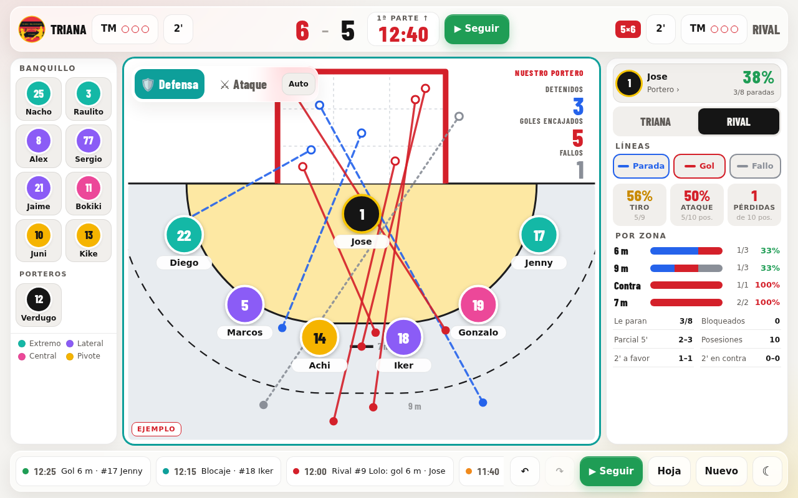
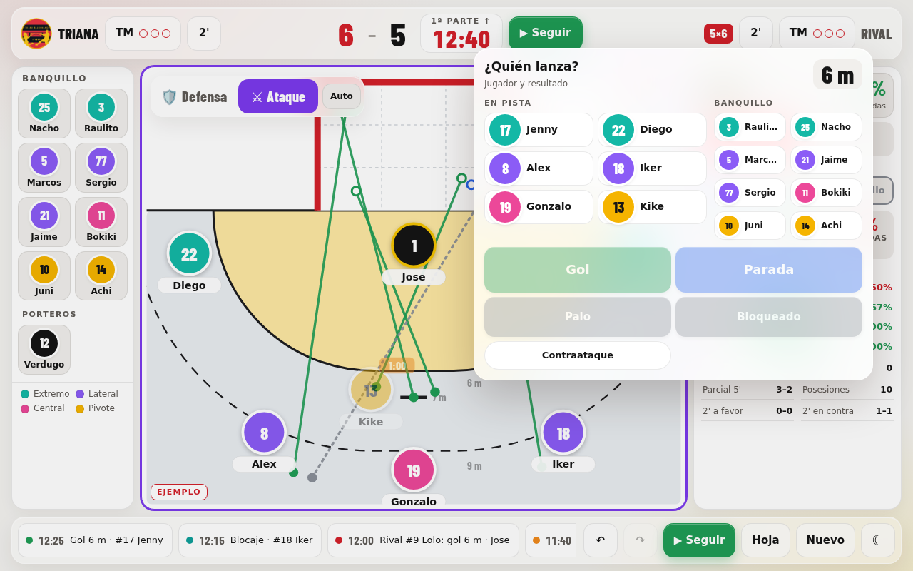
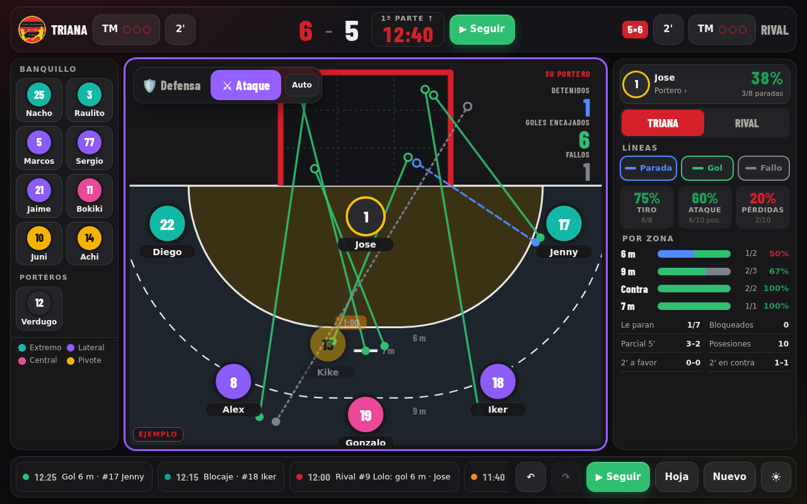
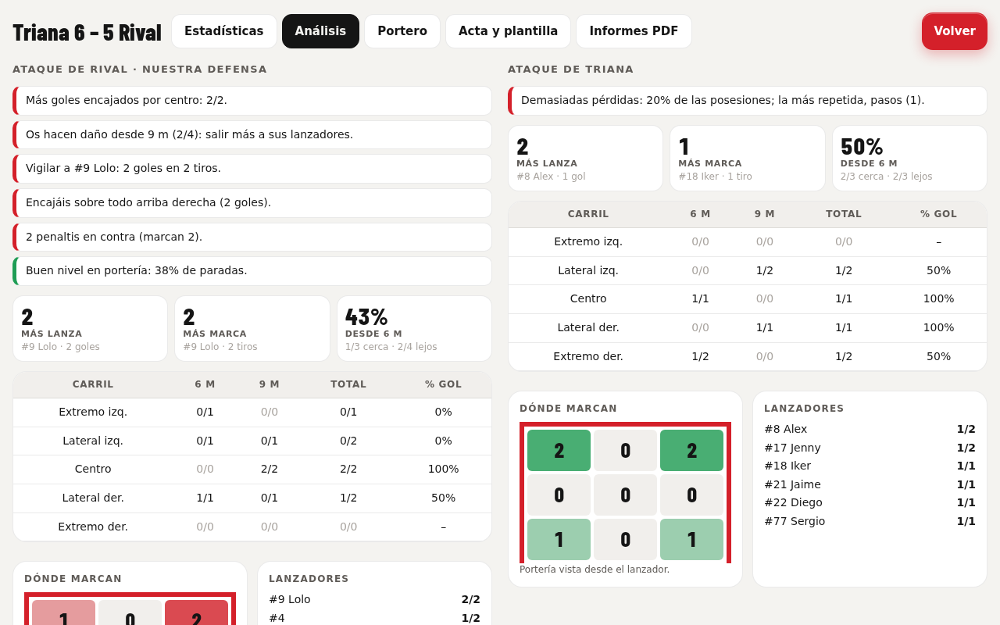
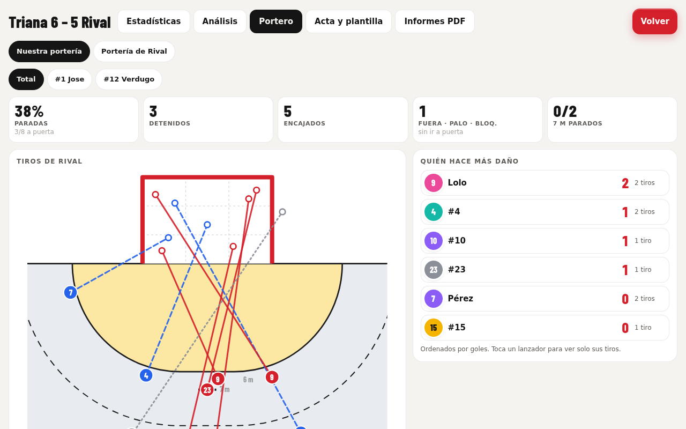
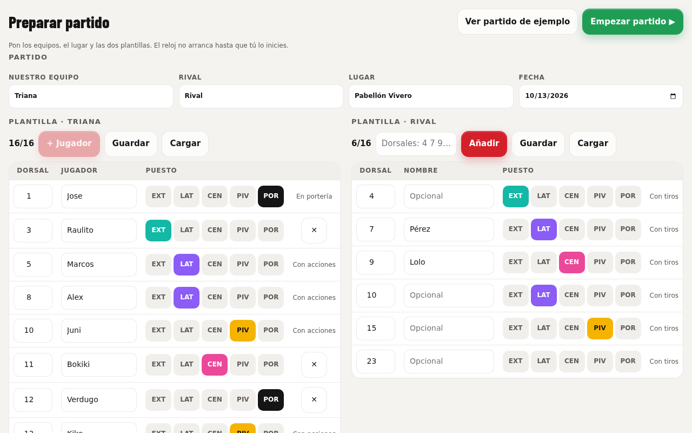
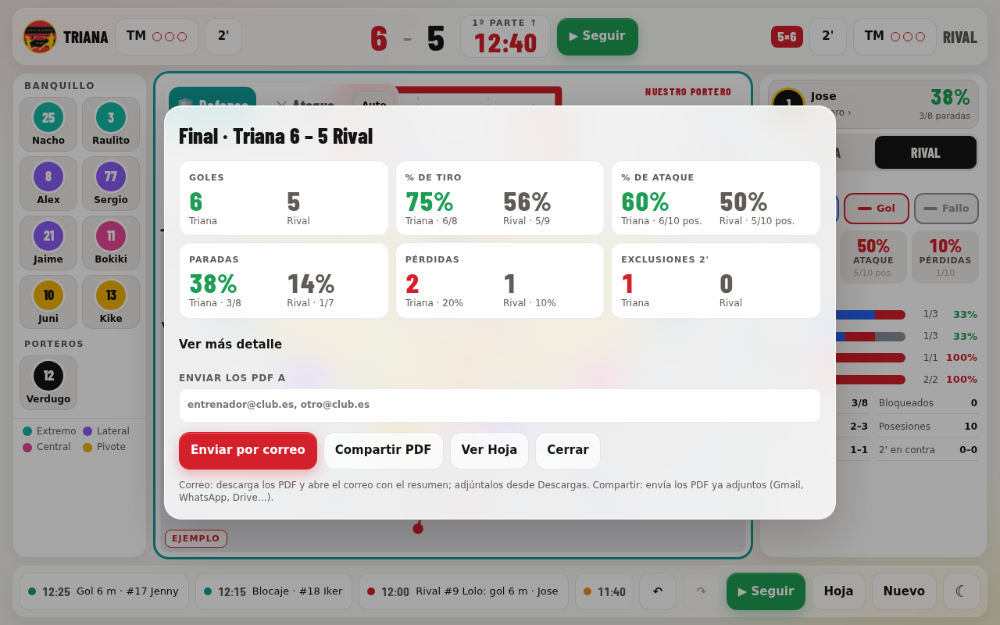

<div align="center">

# 🤾 HBStats

**Live handball statistics on a landscape tablet: one screen, finger or stylus, works offline.**

Draw every shot in one gesture, drag players on and off court, follow both goalkeepers, and get a
PDF report with key points when the final whistle goes.

[](https://github.com/abuenoa/hbstats/actions/workflows/ci.yml)
[](LICENSE)


[](CONTRIBUTING.md)

[**Try it live**](https://abuenoa.github.io/hbstats/triana/) ·
[Report a bug](https://github.com/abuenoa/hbstats/issues/new?template=bug_report.yml) ·
[Suggest an idea](https://github.com/abuenoa/hbstats/issues/new?template=feature_request.yml) ·
[🇪🇸 En español](#-en-español)

<br>



<sub>Defence view of the sample match: every rival shot on our goalkeeper, saves in blue, goals in red, misses in grey.</sub>

</div>

<details>
<summary><b>Table of contents</b></summary>

- [Why HBStats](#why-hbstats)
- [Features](#features)
- [A match, step by step](#a-match-step-by-step)
- [Install it on a tablet](#install-it-on-a-tablet)
- [For clubs](#for-clubs)
- [Development](#development)
- [Roadmap](#roadmap)
- [Contributing](#contributing)
- [Licence](#licence)
- [🇪🇸 En español](#-en-español)

</details>

## Why HBStats

Handball is fast. Paper templates and button-heavy apps make the person on the bench look down
while the game goes on. HBStats is built around **one gesture per action** on a court that is
always visible:

- 🎯 **Draw the shot**: from where it was taken to where it went in the goal, in one stroke.
  Zone (6 m, 9 m, 7 m) and lane are worked out from the line.
- 🖐️ **Tap a player** for everything else: assist, turnover, recovery, block, defensive fault, 2'.
- ⏱️ **Forget the clock**: it starts by itself when you log a play and handles both halves,
  time-outs and exclusions.
- 📴 **No signal, no problem**: once opened, it works offline. Data stays on the tablet; no accounts, no server.

## Features

<table>
<tr>
<td width="50%" valign="top">

### Shot picker in attack
Draw a shot and pick the shooter: players on court in large buttons, the bench beside them,
ordered by position and colour. The last shooter stays selected.

</td>
<td width="50%" valign="top">

### Both teams, same numbers
Switch between your team and the rival: court lines, goalkeeper tallies and live stats
(shooting %, attack %, turnovers, zones) follow the selection, measured the same way for both.

</td>
</tr>
<tr>
<td></td>
<td></td>
</tr>
<tr>
<td width="50%" valign="top">

### Analysis with key points
Who shoots and scores most, where each team gets through (lane × 6 m / 9 m) and where in the goal
they score. Plain-language key points to work on, for defence and attack.

</td>
<td width="50%" valign="top">

### Who hurt each goal most
Our goal or the rival's: every trajectory with the shooter's dorsal, the shooters ranked by goals
(tap one to see only their shots), saves and goals by zone and goal sector. The PDF report has the
same maps and rankings.

</td>
</tr>
<tr>
<td></td>
<td></td>
</tr>
<tr>
<td width="50%" valign="top">

### Match setup first
Both rosters (the rival can be just dorsals), venue and date before the throw-off. Rosters save
and load as files, so the next match starts in seconds.

</td>
<td width="50%" valign="top">

### Final summary and PDFs
At the end, a summary of both teams and the PDF reports (match, key points, each player), sent
by e-mail or shared to WhatsApp, Drive or Gmail.

</td>
</tr>
<tr>
<td></td>
<td></td>
</tr>
</table>

**Also included:** time-outs and 2' for both teams with countdowns and alarms · red and blue cards
(the player is out for good and the team plays 2' short) · separate attack and defence lineups ·
undo / redo for everything · score corrections at any time · light and dark themes · score at
every 5' derived from the goal times.

### Colours that mean the same everywhere

| | Saves | Goals against our keeper | Goals against theirs | Misses |
|---|---|---|---|---|
| Lines, tallies, PDFs | 🔵 blue | 🔴 red | 🟢 green | ⚪ grey |

Players are coloured by position: 🟢 wings · 🟣 backs · 🩷 centre · 🟡 pivots · ⚫ goalkeepers.

## A match, step by step

1. **Prepare**: teams, venue, date and both rosters, then *Empezar partido*.
2. **Place the players** on court for attack and defence by dragging them from the bench.
3. **Play**: draw shots, tap players for other actions. The clock starts with the first play.
4. **Adjust** when needed: tap the clock to pause or type the exact time; tap the score to correct it.
5. **Finish**: the final summary opens with both teams' numbers and the PDFs ready to send.

> [!TIP]
> Not ready for a real match? Tap *Ver partido de ejemplo* on the first screen to explore a match already in progress.

## Install it on a tablet

1. Open your club's page in Chrome (Android) or Safari (iPad), for example
   **https://abuenoa.github.io/hbstats/triana/**.
2. Menu → *Add to home screen* / *Install app*.
3. Open it once with a connection. From then on it works offline, and it updates itself the next
   time it opens online.

Each club has its own page, name, crest, colours and data: see the list at
[abuenoa.github.io/hbstats](https://abuenoa.github.io/hbstats/).

## For clubs

Adding a club takes a crest and a short settings file:

1. Create `tenants/<club>/` (lowercase, digits, hyphens) with a square `escudo.jpg` and a `tenant.json`
   (copy `tenants/triana/tenant.json` and change the values; `brandInk` is the text colour on the brand colour).
2. `python3 tools/make_icons.py <club>`, then `python3 tools/build_site.py`.
3. Commit and push: the club appears in the list at the site root and installs from `/hbstats/<club>/`.

The semantic colours above are the same for every club; brand colours only touch primary buttons,
our score, the background glow and the PDF header. Or [open an issue](https://github.com/abuenoa/hbstats/issues/new?template=feature_request.yml)
with your crest and colours and we will add it.

## Development

The whole app is one HTML file with no framework and no build dependencies. The tools need Python 3
(standard library only) and a headless Chrome.

```sh
python3 tools/run_tests.py           # run the test suite against src/app.html
python3 tools/build_site.py          # regenerate docs/ from src/ and tenants/
python3 tools/make_icons.py [club]   # regenerate a club's icons from its crest (all clubs if none given)
python3 tools/screenshots.py [scene] # refresh the README screenshots from the sample match
```

The scripts find Chrome through the `CHROME` environment variable, a Playwright-installed browser, or
`google-chrome`/`chromium` on the PATH.

<details>
<summary><b>Repository layout</b></summary>

| Path | What it is |
|---|---|
| `src/app.html` | The whole app (markup, styles, script). Single source of truth; also publishable as a Claude artifact, so it has no `<html>`/`<head>` of its own. |
| `src/sw.js` | Service worker (offline). `__CLUB__` and `__BUILD__` are replaced at build time. |
| `tenants/<club>/tenant.json` | Club settings: name, team, brand colours, optional roster (fields in `tools/tenants.py`). |
| `tenants/<club>/escudo.jpg` | Club crest; `icons/` next to it is generated from it. |
| `docs/` | Generated site served by GitHub Pages: `docs/<club>/` per club plus a club list at the root. Do not edit by hand. |
| `tests/inject.js` | In-page test suite (runs inside the app's scope). |
| `tools/` | Build, icon, screenshot and test scripts. |
| `.github/readme/` | README screenshots (generated by `tools/screenshots.py`). |

</details>

<details>
<summary><b>Release and data</b></summary>

**Release.** Edit `src/`, run the tests, run the build, then commit `src/` and `docs/` together and push.
The site updates and installed tablets pick up the new version the next time they open the app online.
CI checks both the tests and that `docs/` is up to date.

**Data.** Matches live in each tablet's browser storage (no server, no accounts). Rosters move between
devices with *Acta → Guardar / Cargar* (JSON files).

**External files** loaded at runtime and cached for offline use: Google Fonts (Barlow Condensed), and
jsPDF 2.5.1 with jsPDF-AutoTable 3.5.31 from cdnjs (only when a PDF is generated).

</details>

## Roadmap

- [x] Live tracking of both teams with shot maps, goalkeepers and analysis
- [x] PDF reports and end-of-match summary
- [x] Installable offline app, one page per club
- [ ] Testing on more tablets with coaches (feedback welcome)
- [ ] Season history and per-player reports across matches
- [ ] Configurable turnover and observation types per coach
- [ ] Android package (APK) from the same app

Have an idea? [Suggest it](https://github.com/abuenoa/hbstats/issues/new?template=feature_request.yml), in Spanish or English.

## Contributing

Issues and pull requests are welcome, in Spanish or English. Read [CONTRIBUTING.md](CONTRIBUTING.md) and
the [code of conduct](CODE_OF_CONDUCT.md). Pull requests are accepted under the
[Contributor License Agreement](CLA.md), and CI must pass (tests and an up-to-date `docs/`).

Coaches who do not code help just as much: try it in a match and
[tell us what got in the way](https://github.com/abuenoa/hbstats/issues/new?template=bug_report.yml).

## Licence

Copyright (C) 2026 Antonio Bueno Antón.

HBStats is free software under the [GNU Affero General Public License v3.0 or later](LICENSE): you may use, study,
modify and share it, and anyone who offers a modified version to users over a network must publish its source
under the same licence. The app links to this repository so every user can get the source.

This is the open edition. A commercial edition with premium features may be offered separately by the copyright
holder; contributions can be included in both under the CLA.

**Club crests and names are not covered by the licence.** `tenants/*/escudo.jpg`, the icons generated from them and
the club names belong to their clubs; do not reuse them without the club's permission.

## 🇪🇸 En español

**HBStats** es una app para apuntar las estadísticas de un partido de balonmano en directo, con la tablet
en horizontal y con el dedo o un lápiz. Todo cabe en una pantalla: la pista con tus jugadores, el marcador
y el reloj, y las estadísticas en vivo.

- **Lanzamientos de un trazo:** dibujas desde dónde se tira hasta dónde va en la portería, y la app sabe si
  es de 6 m, 9 m o 7 m.
- **Los dos equipos:** tu equipo y el rival con las mismas estadísticas, sus porteros y sus lanzadores por dorsal.
- **Análisis y puntos clave:** quién lanza y marca más, por dónde penetran, dónde marcan y qué mejorar.
- **Informes PDF** al acabar, por correo o compartidos por WhatsApp.
- **Sin conexión:** funciona sin cobertura una vez abierta; los datos se quedan en la tablet.

Ábrela en la tablet (por ejemplo **https://abuenoa.github.io/hbstats/triana/**) y usa *Añadir a pantalla de inicio*.
¿Quieres tu club con su escudo y sus colores, o tienes una idea? [Abre una propuesta](https://github.com/abuenoa/hbstats/issues/new?template=feature_request.yml).
